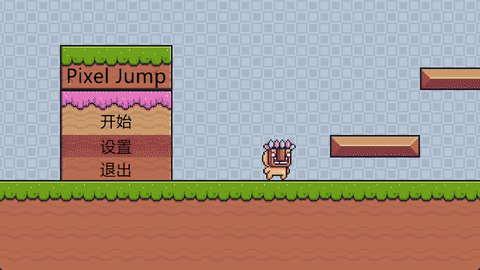
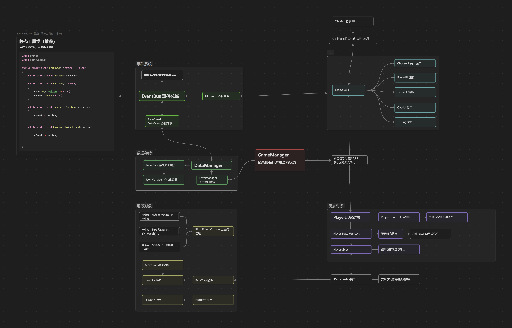
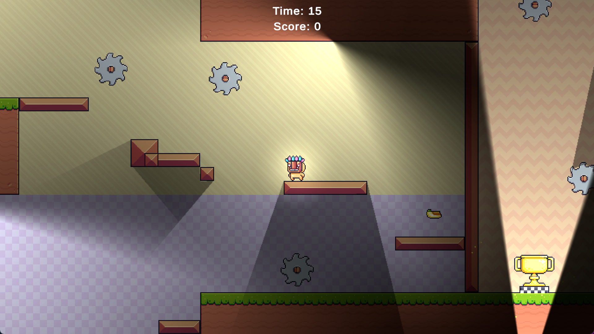

# Pixel_Adventure_DEMO
**大一上Unity寒假练习:2D 简易平台跳跃**
UntiyVersion：2022.3.62f3c1

使用Unity社区2D美术资源，在寒假新年期间用时9天完成。

## 演示视频

| 模块       | 技术亮点                                                |
| :------- | :-------------------------------------------------- |
| **核心玩法** | 平台跳跃、单向平台（Platform Effector 2D + 自定义下落逻辑）、摄像机延迟跟随 |
| **角色系统** | 动画状态机（待机/跑步/跳跃）、扣血/死亡/复活点机制                         |
| **UI架构** | 事件驱动重构（EventBus）、异步加载、场景载入动画                        |
| **游戏循环** | 主菜单、暂停、关卡切换、计分计时、数据持久化（JSON）                        |
| **架构设计** | 管理器分层（GameManager/LevelManager/DataManager）、泛型单例基类  |

## 设计框架

## 闲聊
这是我的第一个阶段性练习Demo，回顾了之前的学习的2D Animator/Tilemap 的简单使用；数据持久化和单例管理脚本的使用。
由于跟随教程的学习效率并不高，于是自己开了个坑自己从头设计和实现。
主要的目的处于熟悉制作流程和引擎的环节，所以没有涉及比较进阶的内容。

其实在项目的前3-4天就已经跑通游戏的闭环了，因为游戏机制和内容方面我制作的比较少和简单。
但是在中期我就已经感受到单例生命周期难以管理的问题：制作过程中由于所有的UI界面都是依赖单例，且涉及到场景内延迟实例化，所以很快出现了大量空引用问题。
于此同时，UI和DataManager之间的数据读取，也逐渐变得繁琐。

所以我想到了之前了解到的使用事件和委托解耦，我通过AI学习到了EventBus这种方法，在隔离不同的事件的同时，还避免了单例生命周期问题。
在了解到 数据传输对象 的概念之后，使用 代表事件发生的类对象 进行事件的触发，从而传递各种信息和数据。
在学习之后我立刻修改了所有UI的调用，和数据传递的过程，通过数据驱动来实现。不仅获得了更加简单的代码，也更利于拓展，这应该是此项目最大的收获之一。

此外，还遇到了大量细节问题，不过都已经一一解决。整体制作下来熟悉了2D的基本组件，也增加了对框架的一些理解。
后续应该会对更进阶的内容进行学习和总结！

